# AWS DAS Processor

[](https://github.com/divmora/aws-das-processor/releases)
[](https://github.com/divmora/.github/blob/main/LICENSING.md)
[](https://github.com/divmora/aws-das-processor/actions)
[](go.mod)
[](https://divmora.github.io/aws-das-processor/)
[](https://deepwiki.com/divmora/aws-das-processor)
[](SECURITY.md)

[Documentation](https://divmora.github.io/aws-das-processor/) • [Roadmap](ROADMAP.md) • [Ask DeepWiki](https://deepwiki.com/divmora/aws-das-processor)

## Architecture

```mermaid
flowchart LR
    RDS[("Amazon RDS / Aurora")] -->|"Streams activity records"| Kinesis["Kinesis Data Stream"]
    Kinesis -->|"Subscribes & delivers"| Firehose["Amazon Data Firehose"]
    Firehose -->|"Writes raw chunks"| S3Source[("Source S3 Bucket")]
    S3Source -->|"EventBridge (Default)"| SQS["SQS Queue"]
    S3Source -.->|"Classic SNS Fanout"| SQS
    SQS -->|"Partial Batch Polling"| Lambda["Go Lambda Processor"]
    Lambda -->|"KMS Decrypt Context"| KMS["AWS KMS"]
    Lambda -->|"GZIP / ZLIB Decompress"| Decompress["Decompression"]
    Decompress -->|"JSON Records"| Filter["Declarative YAML Filter DSL"]
    Filter -->|"Retained Events"| Parquet["Parquet-Go Serialization"]
    Parquet -->|"Snappy-compressed Parquet"| S3Dest[("Analytics S3 Sink")]
```

<p align="center">
  
</p>



## Overview & Key Features

`aws-das-processor` is a high-performance Go AWS Lambda consumer designed to process AWS RDS Database Activity Streams (DAS):
- **Decoupled SQS Ingestion**: Flexible decoupled ingestion supporting both modern **Amazon EventBridge to SQS** (default) and classic **Amazon SNS to SQS** fanout, with SQS partial batch failure handling (`ReportBatchItemFailures`).
- **Dynamic Resource ID & Envelope Decryption**: Decrypts raw encrypted DAS log payloads using AWS KMS and the AWS Encryption SDK for Go. Automatically extracts the RDS Resource ID (`cluster-*` or `db-*`) from incoming S3 key prefixes with fallback to `DAS_RDS_RESOURCE_ID` for KMS encryption context matching.
- **Decompression & Streaming**: Decompresses GZIP and zlib payloads (with automatic magic byte detection) and parses database activity event records.
- **Multi-Filter Matching Engine**: Evaluates activity records against multiple filter rule-sets simultaneously (`filters/*.yaml`). Downloads and decrypts the encrypted payload **once**, then fans out to all matching filters in memory to generate distinct analytical datasets with minimal KMS API cost and Lambda execution latency.
- **Configurable Event Filtering**: Heartbeat pruning, field-dropping (e.g. sensitive query literals or client MACs), and recursive AST query rules (`selector`, `dimensionExists`, `and`, `or`, `not`, `contains`).
- **Parquet Serialization & Partitioning**: Converts filtered records to compressed Apache Parquet format and sinks them into an analytical S3 destination bucket partitioned by Hive partition projection (`cluster=.../year=...`), standard date hierarchy, or mirrored paths.

---

## Multi-Filter Matching Engine

A single RDS Database Activity Stream often feeds multiple analytical consumers (e.g. general compliance audit, privileged user monitoring, and real-time security DDL alerts). Running multiple separate Lambda consumers causes redundant KMS decryption calls, increasing AWS KMS costs and S3 egress.

`aws-das-processor` solves this with an in-memory **Single-Decrypt, Multi-Filter Engine**:
1. When an S3 event notification arrives, the Lambda extracts the cluster identifier and S3 key.
2. The Lambda determines which filters in `filters/` match the incoming file based on `match.clusters` and `match.paths`.
3. The raw log chunk is downloaded from S3, the KMS envelope key is decrypted **once**, and the payload is decompressed **once**.
4. The parsed event stream is filtered and serialized independently for each matching filter, producing separate partitioned Parquet outputs.
5. If a filter's query matches 0 records in a given batch, writing an empty Parquet file to S3 is skipped.

```
                    ┌─────────────────────────┐
                    │ Raw S3 DAS Log Chunk    │
                    └───────────┬─────────────┘
                                │
                                ▼
                    ┌─────────────────────────┐
                    │ 1x S3 Download &        │
                    │ 1x KMS Envelope Decrypt │
                    └───────────┬─────────────┘
                                │
                                ▼
                    ┌─────────────────────────┐
                    │ In-Memory Decompress &  │
                    │ Multi-Filter Matcher    │
                    └───────┬─────────┬───────┘
                            │         │
             ┌──────────────┘         └──────────────┐
             ▼                                       ▼
  ┌──────────────────────┐               ┌──────────────────────┐
  │ Filter: compliance   │               │ Filter: security-ddl │
  │ (Hive / Parquet)     │               │ (Date / Parquet)     │
  └──────────┬───────────┘               └──────────┬───────────┘
             ▼                                      ▼
  s3://analytical-bucket/                 s3://analytical-bucket/
  das/compliance/cluster=.../             secops/security-ddl/...
```

### Filter Specification & Configuration Reference

Each filter profile defined in `filters/<name>.yaml` controls event routing, payload field redaction, AST record evaluation, and analytical Parquet destination formatting.

```yaml
name: compliance
enabled: true # Set to false to disable without deleting the file
kms_region: "eu-west-1" # Optional: AWS region of source KMS CMK for cross-region decryption

# Event matching & routing criteria
match:
  clusters:
    - "cluster-EXAMPLE1234567890ABCDEF" # Exact cluster match
    - "cluster-PROD-*"                  # Wildcard cluster match
    - "*"                               # Match any cluster
  paths:
    - "firehose/*"                      # Wildcard path pattern
    - "AWSLogs/123456789012/RDS/*"      # AWS native log prefix
  buckets:
    - "aws-das-logs-raw-*"              # Source S3 bucket wildcard

# Field-level redaction (stripped before writing to Parquet)
drop:
  - clientMac
  - clientApplication

# Recursive AST query filter
query:
  type: not
  field:
    type: or
    fields:
      - type: selector
        dimension: dbUserName
        value: "rdsadmin"
      - type: contains
        dimension: commandText
        value: "SELECT 1"

# Analytical destination output configuration
output:
  bucket: "secops-audit-vault"         # Target S3 bucket (overrides DAS_OUTPUT_BUCKET)
  kms_key_id: "alias/secops-das-key"   # Target KMS key for SSE-KMS (overrides DAS_OUTPUT_KMS_KEY_ID)
  format: hive                         # Partitioning format: "hive" | "date" | "mirrored"
  prefix: das                          # Base S3 prefix (default: "das", set "" for bucket root)
  include_filter: true                 # Include /<filter-name>/ in S3 path (default: false)
```

#### Top-Level Fields

| Field | Type | Required | Default | Description |
|:---|:---|:---|:---|:---|
| `name` | string | Optional | Filename base | Unique filter identifier. Used in logs, fallback resolution, and S3 paths when `include_filter: true`. |
| `enabled` | boolean | Optional | `true` | Enables or disables the filter. Disabled filters (`enabled: false`) are ignored during event routing. |
| `kms_region` | string | Optional | `""` | AWS region of the source KMS CMK used to decrypt DAS log payloads (overrides `DAS_KMS_REGION_NAME`). |
| `match` | object | Optional | `{}` | Ingestion routing criteria (`clusters`, `paths`, `buckets`). If omitted, acts as a fallback default filter. |
| `drop` | array | Optional | `[]` | List of field names to strip from database activity records prior to Parquet serialization. |
| `query` | object | Optional | `{}` | Recursive AST query expression evaluated against each record. Empty matches all records. |
| `output` | object | Optional | `{}` | Parquet destination S3 bucket, SSE-KMS encryption key, prefix, and partition formatting. |

---

### Ingestion Matching Rules (`match`)

The `match` block defines which incoming raw S3 delivery objects should be processed by this filter:

- **`match.clusters`**: List of database cluster or instance identifier patterns (e.g. `["cluster-*"]`, `["db-prod-01"]`). Evaluated against the RDS Resource ID dynamically extracted from the S3 key path or `DAS_RDS_RESOURCE_ID`.
- **`match.paths`**: List of S3 key path patterns or directory prefixes (e.g. `["firehose/*"]`, `["AWSLogs/*/DAS/*"]`). Directory prefixes ending with `/` perform fast prefix matching.
- **`match.buckets`**: List of raw source S3 bucket name patterns (e.g. `["aws-das-logs-raw-*"]`, `["my-app-logs"]`).
- **Pattern Matching Rules**:
  - `*` matches zero or more characters.
  - `?` matches any single character.
  - Comparisons are case-insensitive.
  - Directory prefixes ending with `/` match any key starting with that prefix.
  - If multiple criteria (`clusters`, `paths`, `buckets`) are configured, **all** defined criteria must match (AND logic).

---

### Field Stripping (`drop`)

The `drop` block accepts a list of event dimension keys to remove from the JSON records before writing them into Parquet:

```yaml
drop:
  - clientMac
  - clientApplication
  - serverHost
  - pid
```

- Protects sensitive internal data and eliminates telemetry noise.
- Stripping operates on an in-memory shallow copy per filter, allowing multiple filters matching the same event to strip different fields independently without mutating shared payloads.

---

### Recursive AST Query Engine (`query`)

The `query` block provides a composable Abstract Syntax Tree (AST) engine that evaluates each database activity record. If an event evaluates to `true`, it is serialized to Parquet; otherwise, it is dropped. *(Note: AWS DAS heartbeat events are automatically pruned by the engine).*

#### Supported Query Operators

| Operator | Required Fields | Description | Example |
|:---|:---|:---|:---|
| **`selector`** | `dimension`, `value` | Exact equality match (`record[dimension] == value`). | `type: selector`<br>`dimension: command`<br>`value: DROP` |
| **`dimensionExists`** | `dimension` | Checks if a dimension key exists in the record. | `type: dimensionExists`<br>`dimension: errorMessage` |
| **`contains`** | `dimension`, `value` | Evaluates substring containment for strings, item membership for arrays, or key presence for maps. | `type: contains`<br>`dimension: commandText`<br>`value: "SELECT 1"` |
| **`not`** | `field` | Logical NOT. Inverts the boolean result of the nested sub-query. | `type: not`<br>`field: { ... }` |
| **`and`** | `fields` | Logical AND. Evaluates to `true` only if every nested sub-query evaluates to `true`. | `type: and`<br>`fields: [ { ... }, { ... } ]` |
| **`or`** | `fields` | Logical OR. Evaluates to `true` if at least one nested sub-query evaluates to `true`. | `type: or`<br>`fields: [ { ... }, { ... } ]` |

#### AST Operator Examples

##### 1. Exact Equality (`selector`)
```yaml
query:
  type: selector
  dimension: command
  value: DROP
```

##### 2. Dimension Existence (`dimensionExists`)
```yaml
query:
  type: dimensionExists
  dimension: errorMessage
```

##### 3. Substring & Array Membership (`contains`)
```yaml
# Matches if commandText contains "pg_sleep"
query:
  type: contains
  dimension: commandText
  value: "pg_sleep"
```

##### 4. Compound Logic (`not`, `and`, `or`)
```yaml
# Drop internal queries while keeping real application traffic
query:
  type: not
  field:
    type: or
    fields:
      - type: selector
        dimension: dbUserName
        value: rdsadmin
      - type: contains
        dimension: commandText
        value: "rds_heartbeat"
      - type: contains
        dimension: commandText
        value: "pg_stat_statements"
```

---

### Database Activity Stream Event Dimensions Reference

All records produced by RDS Database Activity Streams are parsed and mapped to the following schema. You can query any of these fields in `query.dimension` or redact them in `drop`:

| Dimension (Field) | Type | Parquet Encoding | Description & Sample Values |
|:---|:---|:---|:---|
| `logTime` | string | Dictionary | Timestamp when the database executed the event (e.g. `"2026-10-12 09:30:15.123"`). |
| `statementId` | int64 | Plain | Sequential statement identifier within the database session. |
| `substatementId` | int64 | Plain | Sequential substatement identifier for nested/trigger executions. |
| `objectType` | string | Dictionary | Type of database object accessed (e.g. `"TABLE"`, `"VIEW"`, `"INDEX"`, `"DATABASE"`). |
| `command` | string | Dictionary | High-level database operation (e.g. `"SELECT"`, `"INSERT"`, `"UPDATE"`, `"DELETE"`, `"DROP"`, `"ALTER"`, `"CREATE"`). |
| `objectName` | string | Dictionary | Name of the database object accessed (e.g. `"users"`, `"orders"`). |
| `databaseName` | string | Dictionary | Name of the active database (e.g. `"production_app"`). |
| `dbUserName` | string | Dictionary | Database user executing the command (e.g. `"app_service"`, `"rdsadmin"`, `"dba_admin"`). |
| `remoteHost` | string | Dictionary | Client hostname or IP address initiating the database connection. |
| `sessionId` | string | Dictionary | Unique session identifier for the database connection. |
| `rowCount` | int64 | Plain | Number of rows affected or returned by the command execution. |
| `commandText` | string | Dictionary | Full SQL query or command executed by the client. |
| `paramList` | []string | List | Bound parameter values supplied with prepared statements. |
| `pid` | int64 | Plain | Operating system process ID of the database server backend process. |
| `clientApplication` | string | Dictionary | Client application or driver name (e.g. `"PostgreSQL JDBC Driver"`, `"psql"`, `"DBeaver"`). |
| `exitCode` | string | Dictionary | Database execution exit code or status (normalized to string, e.g. `"0"`). |
| `class` | string | Dictionary | Activity class category (e.g. `"READ"`, `"WRITE"`, `"MISC"`). |
| `serverHost` | string | Dictionary | Database server host or instance endpoint handling the request. |
| `type` | string | Dictionary | Event record classification (e.g. `"record"`, `"heartbeat"`). |
| `startTime` | string | Dictionary | Timestamp when statement execution started. |
| `errorMessage` | string | Dictionary | Detailed error message or exception if statement execution failed. |

---

## Configuration / Environment Variables

| Variable | Default | Description |
|:---|:---|:---|
| `DAS_FILTERS_DIR` | `${LAMBDA_TASK_ROOT}/filters` or `"filters"` | Path to the directory containing `.yaml` filter rules. In AWS Lambda, automatically discovers `${LAMBDA_TASK_ROOT}/filters`. |
| `DAS_RDS_RESOURCE_ID` | `""` | Fallback RDS Resource ID (e.g. `cluster-EXAMPLE1234567890ABCDEF`) for KMS encryption context. Automatically discovered from S3 object key paths (`cluster-*` or `db-*`) if present. |
| `DAS_KMS_REGION_NAME` | Current AWS Region | Fallback AWS Region for KMS envelope decryption when not specified in the matching filter (`kms_region`). |
| `DAS_OUTPUT_BUCKET` | Source Bucket | Destination S3 analytical bucket for writing processed Parquet files (defaults to the incoming source bucket if unset). |
| `DAS_OUTPUT_FORMAT` | `hive` | Output partition format override (`hive`, `date`, `mirrored`). Configurable in filter files under `output.format`. |
| `DAS_OUTPUT_PREFIX` | `das` | Base S3 prefix in destination bucket. Configurable in filter files under `output.prefix`. |
| `DAS_OUTPUT_INCLUDE_FILTER` | `false` | Whether to include `/<filter-name>/` in the destination path (`true`/`false`). Recommended `true` when running multiple filters. |
| `DAS_OUTPUT_KMS_KEY_ID` | `""` | Optional AWS KMS key ID/ARN to enforce SSE-KMS encryption on output Parquet objects. |
| `DAS_KEY_NAME` | `DataKey` | Key name for the AWS Encryption SDK raw AES keyring (standard RDS DAS key name). |
| `DAS_KEY_NAMESPACE` | `""` | Optional custom key provider namespace for raw AES keyring decryption. Defaults to `"BC"` (BouncyCastle) and `"RawMasterKeyProvider"`. |

### Dynamic RDS Resource ID Discovery

`aws-das-processor` dynamically inspects S3 object key paths to extract the RDS DB cluster identifier (`cluster-...`) or DB instance identifier (`db-...`) needed for the AWS KMS encryption context (`aws:rds:dbc-id`).

It is prefix-agnostic and supports various delivery topologies:
- **Standard Firehose DAS prefix**: `AWSLogs/<AccountID>/DAS/<Region>/cluster-EXAMPLE1234567890ABCDEF/YYYY/MM/DD/HH/...`
- **Generic Firehose delivery**: `firehose/cluster-EXAMPLE1234567890ABCDEF/YYYY/MM/DD/HH/...`
- **Native RDS S3 export**: `AWSLogs/<AccountID>/RDS/<Region>/cluster-EXAMPLE1234567890ABCDEF/YYYY/MM/DD/...`
- **Custom nested prefixes**: `custom/prefix/db-ABCDEFGHIJKLMNOPQRSTUVWXYZ/file.json`

If an incoming S3 key does not contain a recognizable cluster or instance prefix, the processor falls back to the configured `DAS_RDS_RESOURCE_ID` environment variable.

### Input Stream Ingestion Setup (Amazon Data Firehose)

When you enable Database Activity Streams (DAS) on an Amazon Aurora DB cluster or Amazon RDS DB instance, AWS publishes encrypted, zlib-compressed records to a dedicated Amazon Kinesis data stream (`aws-rds-das-cluster-<cluster-id>` or `aws-rds-das-db-<instance-id>`).

To deliver these records into your raw source S3 bucket, configure an **Amazon Data Firehose** delivery stream with `UNCOMPRESSED` format (since DAS records are already encrypted and compressed within the payload envelope):

```bash
aws firehose create-delivery-stream \
  --delivery-stream-name das-stream-to-s3-cluster-EXAMPLE1234567890ABCDEF \
  --region us-east-1 \
  --delivery-stream-type KinesisStreamAsSource \
  --kinesis-stream-source-configuration "KinesisStreamARN=arn:aws:kinesis:us-east-1:123456789012:stream/aws-rds-das-cluster-EXAMPLE1234567890ABCDEF,RoleARN=arn:aws:iam::123456789012:role/service-role/KinesisFirehoseServiceRole" \
  --extended-s3-destination-configuration '{
      "RoleARN": "arn:aws:iam::123456789012:role/service-role/KinesisFirehoseServiceRole",
      "BucketARN": "arn:aws:s3:::aws-das-logs-raw-123456789012-us-east-1",
      "Prefix": "AWSLogs/123456789012/DAS/us-east-1/cluster-EXAMPLE1234567890ABCDEF/",
      "ErrorOutputPrefix": "AWSLogs/123456789012/DAS/us-east-1/cluster-EXAMPLE1234567890ABCDEF/errors/",
      "CompressionFormat": "UNCOMPRESSED"
  }'
```

> **Prefix Best Practice**: Setting `Prefix` to `AWSLogs/<AccountID>/DAS/<Region>/cluster-EXAMPLE1234567890ABCDEF/` allows `aws-das-processor` to dynamically discover the RDS Resource ID directly from S3 key directory segments, ensuring exact matching of the KMS encryption context (`aws:rds:dbc-id`).
>
> **Multi-Layer Error Manifest Filtering**:
> - **At EventBridge (Edge/Ingestion Filter)**: The EventBridge rule natively filters out error delivery manifests with `anything-but.wildcard: ['*/errors/*', '*/error/*']`, dropping error events at the event bus so they never enter SQS or trigger Lambda invocations.
> - **At Processor Runtime (Defense-in-Depth)**: The Go processor runtime automatically inspects incoming keys with `IsIgnoredS3Key`, gracefully acknowledging and skipping any error objects delivered via direct S3 notifications or SNS fanout without unmarshal errors or dead-letter queue (DLQ) retries.

### Cross-Region KMS Decryption

`aws-das-processor` dynamically routes `kms:Decrypt` API calls to the target regional endpoint using a hierarchical fallback:

1. **Filter Configuration (`kms_region`)**: Explicitly configured per filter profile in `filters/<name>.yaml` (e.g. `kms_region: "eu-west-1"`).
2. **Environment Variable Fallback (`DAS_KMS_REGION_NAME`)**: Global fallback region environment variable.
3. **Ambient Default**: If neither is set, defaults to the Lambda's ambient execution region (`AWS_REGION`).

This allows a centralized processor deployed in a single region (e.g., `us-east-1`) to seamlessly ingest and decrypt database activity streams from databases across multiple AWS regions without requiring multiple processor deployments or complex routing infrastructure. *(Note: If using AWS KMS Multi-Region Keys (MRK) with replicas in the processor's region, regional overrides are not required.)*

### Destination S3 Partitioning & Bucket Routing

Destination S3 buckets, encryption keys, and partitioning formats are configurable per filter profile in `filters/<name>.yaml` under the `output` block:

```yaml
output:
  bucket: "secops-audit-vault"         # Target S3 bucket (overrides DAS_OUTPUT_BUCKET)
  kms_key_id: "alias/secops-das-key"   # Target KMS key for SSE-KMS (overrides DAS_OUTPUT_KMS_KEY_ID)
  format: "hive"                       # Options: "hive" | "date" | "mirrored" (default: "hive")
  prefix: "das"                        # Base S3 prefix (default: "das", set "" for bucket root)
  include_filter: true                 # Whether to include /<filter-name>/ in S3 path (default: false)
```

#### Destination Resolution Hierarchy
1. **Target Bucket**: Filter `output.bucket` &rarr; Environment `DAS_OUTPUT_BUCKET` &rarr; Incoming source S3 bucket.
2. **KMS Encryption Key**: Filter `output.kms_key_id` &rarr; Environment `DAS_OUTPUT_KMS_KEY_ID` (unencrypted S3 default if neither is set).

| Format | Structure in Destination S3 | Best Used For |
|:---|:---|:---|
| **`hive`** | `[prefix/][<filter>/]cluster=<cluster-id>/year=YYYY/month=MM/day=DD/hour=HH/<file>.parquet` | **Amazon Athena & AWS Glue**: Direct partition projection and query optimization. |
| **`date`** | `[prefix/][<filter>/]<cluster-id>/YYYY/MM/DD/HH/<file>.parquet` | **Data Lake / Snowflake / Databricks**: Clean standard chronological folder hierarchy. |
| **`mirrored`** | `[prefix/][<filter>/]<source-path>-processed.parquet` | **1-to-1 Stream Mirroring**: Preserves source S3 delivery structure. |


---

## IAM Permissions

The Lambda execution role requires the following least-privilege IAM policy permissions:

```json
{
  "Version": "2012-10-17",
  "Statement": [
    {
      "Sid": "SourceBucketAccess",
      "Effect": "Allow",
      "Action": [
        "s3:GetObject"
      ],
      "Resource": "arn:aws:s3:::your-source-das-bucket/*"
    },
    {
      "Sid": "DestinationBucketAccess",
      "Effect": "Allow",
      "Action": [
        "s3:PutObject"
      ],
      "Resource": "arn:aws:s3:::your-destination-parquet-bucket/*"
    },
    {
      "Sid": "KmsDecryptAccess",
      "Effect": "Allow",
      "Action": [
        "kms:Decrypt",
        "kms:GenerateDataKey"
      ],
      "Resource": "arn:aws:kms:region:account-id:key/your-das-key-id"
    },
    {
      "Sid": "SqsConsumerAccess",
      "Effect": "Allow",
      "Action": [
        "sqs:ReceiveMessage",
        "sqs:DeleteMessage",
        "sqs:GetQueueAttributes"
      ],
      "Resource": "arn:aws:sqs:region:account-id:your-das-processor-queue"
    },
    {
      "Sid": "CloudWatchLogs",
      "Effect": "Allow",
      "Action": [
        "logs:CreateLogGroup",
        "logs:CreateLogStream",
        "logs:PutLogEvents"
      ],
      "Resource": "arn:aws:logs:*:*:*"
    }
  ]
}
```

---

## Deployment via CloudFormation

`aws-das-processor` supports both **Amazon EventBridge to SQS** (modern standard default) and **Amazon SNS to SQS** (classic fanout). The Go runtime automatically detects and parses both envelope formats.

### Option A: Modern Architecture via EventBridge (Recommended)

Requires only enabling EventBridge notifications on your source S3 bucket(s) (`EventBridgeEnabled: true`). Supports one or multiple source buckets, eliminates S3 prefix-overlap restrictions, and natively filters out Firehose error manifests before queue delivery:

```bash
aws cloudformation deploy \
  --template-file deploy/cloudformation/lambda.yaml \
  --stack-name aws-das-processor \
  --capabilities CAPABILITY_IAM \
  --parameter-overrides \
    DasSourceBucketNames=aws-das-logs-raw-123456789012-us-east-1,aws-das-logs-raw-123456789012-us-west-2 \
    DasDestinationBucketName=analytics-das-parquet-bucket \
    KmsKeyArn=arn:aws:kms:us-east-1:123456789012:key/your-das-key-id \
    LambdaImageUri=123456789012.dkr.ecr.us-east-1.amazonaws.com/aws-das-processor:latest
```

### Option B: Classic Architecture via SNS Fanout

For environments with an existing SNS topic receiving S3 notifications across one or multiple source buckets:

```bash
aws cloudformation deploy \
  --template-file deploy/cloudformation/lambda-sns.yaml \
  --stack-name aws-das-processor-sns \
  --capabilities CAPABILITY_IAM \
  --parameter-overrides \
    DasSnsTopicArn=arn:aws:sns:us-east-1:123456789012:das-sns-topic \
    DasSourceBucketArns=arn:aws:s3:::aws-das-logs-raw-123456789012-us-east-1,arn:aws:s3:::aws-das-logs-raw-123456789012-us-west-2 \
    DasDestinationBucketName=analytics-das-parquet-bucket \
    KmsKeyArn=arn:aws:kms:us-east-1:123456789012:key/your-das-key-id \
    LambdaImageUri=123456789012.dkr.ecr.us-east-1.amazonaws.com/aws-das-processor:latest
```

### CloudFormation Parameters Reference

| Parameter | Default | Applies To | Description |
|:---|:---|:---|:---|
| `DasSourceBucketNames` | *(Required)* | EventBridge (`lambda.yaml`) | Comma-delimited list of source S3 bucket names (EventBridge enabled). |
| `DasSnsTopicArn` | *(Required)* | SNS (`lambda-sns.yaml`) | Existing SNS topic ARN receiving S3 ObjectCreated notifications. |
| `DasSourceBucketArns` | *(Required)* | SNS (`lambda-sns.yaml`) | Comma-delimited list of source S3 bucket ARNs for queue policy. |
| `DasDestinationBucketName` | *(Required)* | Both | Destination analytical S3 bucket for Parquet output (`DAS_OUTPUT_BUCKET`). |
| `LambdaImageUri` | *(Required)* | Both | ECR container image URI for `aws-das-processor`. |
| `KmsKeyArn` | `*` | Both | KMS Key ARN used to encrypt raw DAS logs (`*` for multi-key environments). |
| `RdsResourceId` | `""` | Both | Optional fallback RDS Resource ID (`DAS_RDS_RESOURCE_ID`). |
| `DasFiltersDir` | `""` | Both | Custom filter directory path (`DAS_FILTERS_DIR`). Defaults to `${LAMBDA_TASK_ROOT}/filters`. |
| `LambdaReservedConcurrency` | `-1` | Both | Reserved concurrent executions for the Lambda function (`-1` = unreserved account pool, `0` = throttled, positive integer = dedicated cap). |
| `SqsMaximumConcurrency` | `50` | Both | Maximum concurrent Lambda invocations triggered by SQS poller via `ScalingConfig` (2–1000). |
| `LambdaMemorySize` | `512` | Both | Function memory in MB (`256`, `512`, `1024`, `1536`, `2048`, `3072`). |
| `LambdaTimeout` | `120` | Both | Function execution timeout in seconds (10–900). |
| `SqsVisibilityTimeout` | `720` | Both | SQS queue visibility timeout in seconds ($\ge$ 6x Lambda timeout). |
| `SqsBatchSize` | `10` | Both | Maximum SQS messages per Lambda invocation (1–10). |
| `SqsBatchingWindowSeconds` | `0` | Both | Gathering window before invoking Lambda (0–300s). |
| `SqsMaxReceiveCount` | `5` | Both | Max deliveries before moving message to the dead-letter queue (DLQ). |
| `LogRetentionDays` | `30` | Both | CloudWatch Logs retention in days. |

---

## Troubleshooting & Common Operational Scenarios

### 1. `Raw AES Keyring was unable to decrypt any encrypted data key ... Expected: keyProviderId: BC`
- **Cause**: Amazon RDS Database Activity Streams use the legacy BouncyCastle (`"BC"`) provider ID and algorithm suite `0x0178` (`ALG_AES256_GCM_IV12_TAG16_HKDF_SHA256`, non-committing). If a decryption client expects `"aws-kms"` or strictly enforces committing policies (`REQUIRE_ENCRYPT_REQUIRE_DECRYPT`), it rejects the ciphertext header.
- **Resolution**: `aws-das-processor` automatically configures `ESDKCommitmentPolicyRequireEncryptAllowDecrypt` and chains `"BC"` and `"RawMasterKeyProvider"` in its multi-keyring. If you are using a custom master key provider, set `DAS_KEY_NAMESPACE=<your-provider-id>`.

### 2. `zlib: invalid header`
- **Cause**: Amazon RDS DAS log chunks may be compressed with GZIP (`0x1F, 0x8B`), standard zlib (`0x78`), or raw uncompressed JSON depending on the database engine version and ingestion stream.
- **Resolution**: `aws-das-processor` features dynamic payload magic-byte sniffing (`crypto.DecompressPayload`) to automatically route data to the appropriate decompressor. Ensure you are using version `0.1.0` or later.

### 3. `missing RDS resource ID: unable to extract from S3 key and no fallback DAS_RDS_RESOURCE_ID configured`
- **Cause**: The processor could not find a `cluster-*` or `db-*` token in the incoming S3 key path to construct the AWS KMS encryption context (`aws:rds:dbc-id`).
- **Resolution**: Ensure Amazon Data Firehose delivers files with the recommended S3 prefix structure:
  `AWSLogs/<AccountID>/DAS/<Region>/cluster-EXAMPLE1234567890ABCDEF/`
  Alternatively, configure the fallback environment variable `DAS_RDS_RESOURCE_ID=cluster-EXAMPLE1234567890ABCDEF` in your Lambda deployment.

### 4. Recursive Lambda Execution Loops (Source Bucket == Destination Bucket)
- **Cause**: If you configure the destination analytical Parquet files to write back to the same S3 bucket as the source raw DAS logs without proper prefix filtering, S3 `ObjectCreated` events will trigger the Lambda recursively on Parquet outputs.
- **Resolution**:
  - **Best Practice**: Use a dedicated, separate S3 destination bucket (`DAS_OUTPUT_BUCKET`).
  - **Shared Bucket**: If you must use a single bucket, ensure EventBridge or SNS rules strictly filter by raw prefix (`prefix: AWSLogs/` or `firehose/`) and that Parquet outputs are written to a separate prefix (`prefix: das/`).

### 5. Firehose Error Delivery Manifests in Dead-Letter Queue (DLQ)
- **Cause**: When Amazon Data Firehose encounters parsing or delivery retries, it writes JSON error manifests to `ErrorOutputPrefix` (`.../errors/...`). These manifests do not contain DAS records and cause unmarshal failures if consumed as data events.
- **Resolution**:
  - The default EventBridge deployment rule natively filters these out with `anything-but.wildcard: ['*/errors/*', '*/error/*']`.
  - The Go processor runtime provides defense-in-depth via `IsIgnoredS3Key`, gracefully acknowledging and skipping any error objects without DLQ redrives.

### 6. Lambda Throttling & Messages Land in DLQ on Traffic Spikes
- **Cause**: High database write spikes produce many S3 chunks. If the SQS poller scales up aggressively beyond your Lambda function's available concurrency or `LambdaReservedConcurrency`, invocations fail with HTTP 429 (`RateExceeded`), incrementing `ApproximateReceiveCount` until messages are dropped into the DLQ.
- **Resolution**:
  - Set `SqsMaximumConcurrency` (e.g. `20` to `50`) on the Event Source Mapping. This caps the SQS poller fleet so that excess messages wait cleanly in the queue without triggering 429 throttling.
  - If setting `LambdaReservedConcurrency`, ensure $\text{LambdaReservedConcurrency} \ge \text{SqsMaximumConcurrency}$.

---

## Development & Building

### Prerequisites
- Go 1.26+
- Make
- Docker

### Common Commands
- **Build binary locally**: `make build`
- **Run all unit tests**: `make test`
- **Run tests with coverage**: `make test-coverage`
- **Format code**: `make fmt`
- **Run linter**: `make lint`
- **Lint CloudFormation**: `make cfn-lint`
- **Package Lambda zip bundle**: `make lambda-package`
- **Build Docker container**: `make docker-build`
- **Serve documentation locally**: `make docs-serve` (serves `docs/` at `http://localhost:8080`)

---

## Community Links

- [Contributing](CONTRIBUTING.md)
- [Code of Conduct](https://github.com/divmora/.github/blob/main/CODE_OF_CONDUCT.md)
- [Security Policy](SECURITY.md)

---

## License & Commercial Use

Licensed under the **Business Source License 1.1 (BSL 1.1)**.

- **Non-Production Use**: Free for non-production purposes, including local development, testing, staging, QA, CI/CD automated validation, educational purposes, and proof-of-concept evaluation.
- **Production Use**: Deploying or executing in a production environment, or offering as a commercial product or hosted/managed service, requires a valid commercial license (EULA) from DIVMORA Technologies.
- **Change Date**: Converts to the Apache License, Version 2.0 three (3) years from the date of release of the specific version.

For commercial inquiries and enterprise licensing, please contact [licensing@divmora.com](mailto:licensing@divmora.com) or visit [divmora.com](https://divmora.com).
