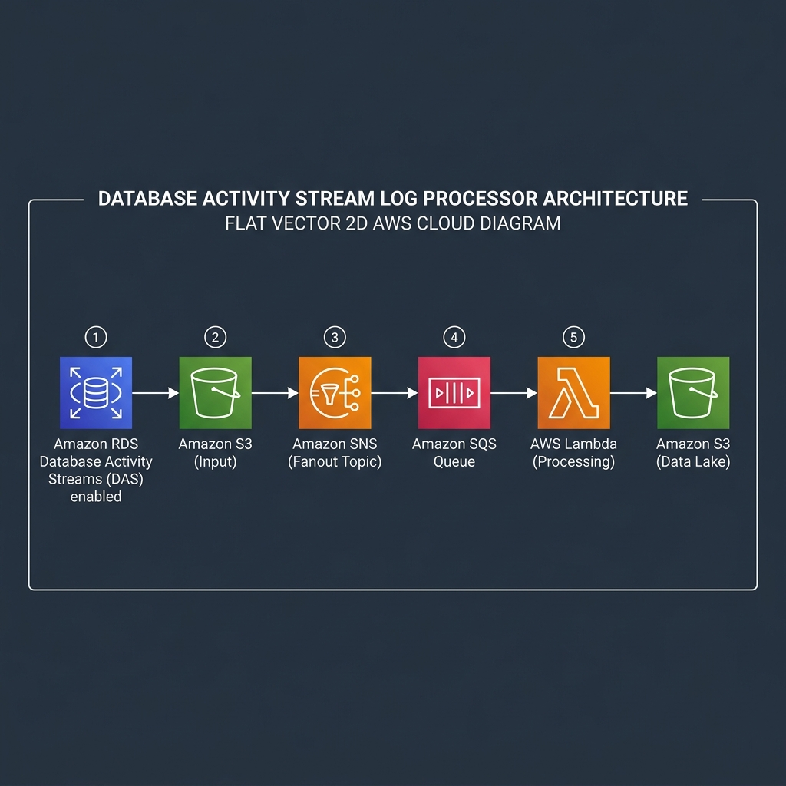

# AWS DAS Processor

[](https://github.com/divmora/aws-das-processor/releases)
[](https://github.com/divmora/.github/blob/main/LICENSING.md)
[](https://github.com/divmora/aws-das-processor/actions)
[](go.mod)
[](https://divmora.github.io/aws-das-processor/)
[](https://deepwiki.com/divmora/aws-das-processor)
[](SECURITY.md)

[Documentation](https://divmora.github.io/aws-das-processor/) • [Roadmap](ROADMAP.md) • [Ask DeepWiki](https://deepwiki.com/divmora/aws-das-processor)

## Architecture

<p align="center">
  
</p>

## Overview & Key Features

`aws-das-processor` is a high-performance Go AWS Lambda consumer designed to process AWS RDS Database Activity Streams (DAS):
- **SQS Fanout Ingestion**: Decoupled S3 bucket notification via SNS to SQS with SQS partial batch failure handling (`ReportBatchItemFailures`).
- **Dynamic Resource ID & Envelope Decryption**: Decrypts raw encrypted DAS log payloads using AWS KMS and the AWS Encryption SDK for Go. Automatically extracts the RDS Resource ID (`cluster-*` or `db-*`) from incoming S3 key prefixes with fallback to `DAS_RDS_RESOURCE_ID` for KMS encryption context matching.
- **Decompression & Streaming**: Decompresses zlib payloads and parses database activity event records.
- **Multi-Filter Matching Engine**: Evaluates activity records against multiple filter rule-sets simultaneously (`filters/*.yaml`, `filters/*.json`). Downloads and decrypts the encrypted payload **once**, then fans out to all matching filters in memory to generate distinct analytical datasets with minimal KMS API cost and Lambda execution latency.
- **Configurable Event Filtering**: Heartbeat pruning, field-dropping (e.g. sensitive query literals or client MACs), and recursive AST query rules (`selector`, `dimensionExists`, `and`, `or`, `not`, `contains`).
- **Parquet Serialization & Partitioning**: Converts filtered records to compressed Apache Parquet format and sinks them into an analytical S3 destination bucket partitioned by Hive partition projection (`cluster=.../year=...`), standard date hierarchy, or mirrored paths.

---

## Multi-Filter Matching Engine

A single RDS Database Activity Stream often feeds multiple analytical consumers (e.g. general compliance audit, privileged user monitoring, and real-time security DDL alerts). Running multiple separate Lambda consumers causes redundant KMS decryption calls, increasing AWS KMS costs and S3 egress.

`aws-das-processor` solves this with an in-memory **Single-Decrypt, Multi-Filter Engine**:
1. When an S3 event notification arrives, the Lambda extracts the cluster identifier and S3 key.
2. The Lambda determines which filters in `filters/` match the incoming file based on `match.clusters` and `match.paths`.
3. The raw log chunk is downloaded from S3, the KMS envelope key is decrypted **once**, and the payload is decompressed **once**.
4. The parsed event stream is filtered and serialized independently for each matching filter, producing separate partitioned Parquet outputs.
5. If a filter's query matches 0 records in a given batch, writing an empty Parquet file to S3 is skipped.

```
                    ┌─────────────────────────┐
                    │ Raw S3 DAS Log Chunk    │
                    └───────────┬─────────────┘
                                │
                                ▼
                    ┌─────────────────────────┐
                    │ 1x S3 Download &        │
                    │ 1x KMS Envelope Decrypt │
                    └───────────┬─────────────┘
                                │
                                ▼
                    ┌─────────────────────────┐
                    │ In-Memory Decompress &  │
                    │ Multi-Filter Matcher    │
                    └───────┬─────────┬───────┘
                            │         │
             ┌──────────────┘         └──────────────┐
             ▼                                       ▼
  ┌──────────────────────┐               ┌──────────────────────┐
  │ Filter: compliance   │               │ Filter: security-ddl │
  │ (Hive / Parquet)     │               │ (Date / Parquet)     │
  └──────────┬───────────┘               └──────────┬───────────┘
             ▼                                      ▼
  s3://analytical-bucket/                 s3://analytical-bucket/
  das/compliance/cluster=.../             secops/security-ddl/...
```

### Filter Matching Rules & Schema

Each filter profile defined in `filters/<name>.yaml` (or `.json`) supports granular matching conditions:

```yaml
name: compliance
enabled: true # Set to false to disable without deleting the file
match:
  clusters:
    - "cluster-EXAMPLE1234567890ABCDEF" # Exact cluster match
    - "cluster-PROD-*"                  # Wildcard cluster match
    - "*"                               # Match any cluster
  paths:
    - "firehose/*"                      # Wildcard path pattern
    - "AWSLogs/123456789012/RDS/*"      # AWS native log prefix
drop:
  - clientMac
  - clientApplication
query:
  type: not
  field:
    type: selector
    dimension: dbUserName
    value: "rdsadmin"
output:
  format: hive          # Options: "hive" | "date" | "mirrored"
  prefix: das           # Analytical S3 prefix
  include_filter: true  # Enables das/compliance/... path isolation
```

- **`enabled`**: Optional boolean (`true` by default). Set to `false` to temporarily skip a filter without deleting the rule file.
- **`match.clusters`**: List of RDS DB cluster/instance patterns. If non-empty, the event's cluster ID must match at least one pattern.
- **`match.paths`**: List of S3 key patterns or directory prefixes. If non-empty, the incoming S3 key must match at least one pattern.
- If both `clusters` and `paths` are configured, **both** must match (AND condition).

---

## Configuration / Environment Variables

| Variable | Default | Description |
|:---|:---|:---|
| `DAS_FILTERS_DIR` | `"filters"` | Path to the directory containing `.yaml`, `.yml`, or `.json` filter rules. |
| `DAS_RDS_RESOURCE_ID` | `""` | Fallback RDS Resource ID (e.g. `cluster-EXAMPLE1234567890ABCDEF`) for KMS encryption context. Automatically discovered from S3 object key paths (`cluster-*` or `db-*`) if present. |
| `DAS_KMS_REGION_NAME` | Current AWS Region | AWS Region where the KMS customer managed key (CMK) resides. |
| `DAS_OUTPUT_BUCKET` | Source Bucket | Destination S3 analytical bucket for writing processed Parquet files (defaults to the incoming source bucket if unset). |
| `DAS_OUTPUT_FORMAT` | `hive` | Output partition format override (`hive`, `date`, `mirrored`). Configurable in filter files under `output.format`. |
| `DAS_OUTPUT_PREFIX` | `das` | Base S3 prefix in destination bucket. Configurable in filter files under `output.prefix`. |
| `DAS_OUTPUT_INCLUDE_FILTER` | `false` | Whether to include `/<filter-name>/` in the destination path (`true`/`false`). Recommended `true` when running multiple filters. |
| `DAS_OUTPUT_KMS_KEY_ID` | `""` | Optional AWS KMS key ID/ARN to enforce SSE-KMS encryption on output Parquet objects. |

### Dynamic RDS Resource ID Discovery

`aws-das-processor` dynamically inspects S3 object key paths to extract the RDS DB cluster identifier (`cluster-...`) or DB instance identifier (`db-...`) needed for the AWS KMS encryption context (`aws:rds:dbc-id`).

It is prefix-agnostic and supports various delivery topologies:
- **Kinesis Data Firehose delivery**: `firehose/cluster-EXAMPLE1234567890ABCDEF/YYYY/MM/DD/HH/...`
- **Native RDS S3 export**: `AWSLogs/<AccountID>/RDS/<Region>/cluster-EXAMPLE1234567890ABCDEF/YYYY/MM/DD/...`
- **Custom nested prefixes**: `custom/prefix/db-ABCDEFGHIJKLMNOPQRSTUVWXYZ/file.json`

If an incoming S3 key does not contain a recognizable cluster or instance prefix, the processor falls back to the configured `DAS_RDS_RESOURCE_ID` environment variable.

### Destination S3 Partitioning Formats

Destination S3 paths are configurable per filter profile in `filters/<name>.yaml` (or `.json`) under the `output` block, and can be overridden via environment variables:

```yaml
output:
  format: "hive"          # Options: "hive" | "date" | "mirrored" (default: "hive")
  prefix: "das"           # Base S3 prefix (default: "das", set "" for bucket root)
  include_filter: true    # Whether to include /<filter-name>/ in S3 path (default: false)
```

| Format | Structure in Destination S3 | Best Used For |
|:---|:---|:---|
| **`hive`** | `[prefix/][<filter>/]cluster=<cluster-id>/year=YYYY/month=MM/day=DD/hour=HH/<file>.parquet` | **Amazon Athena & AWS Glue**: Direct partition projection and query optimization. |
| **`date`** | `[prefix/][<filter>/]<cluster-id>/YYYY/MM/DD/HH/<file>.parquet` | **Data Lake / Snowflake / Databricks**: Clean standard chronological folder hierarchy. |
| **`mirrored`** | `[prefix/][<filter>/]<source-path>-processed.parquet` | **1-to-1 Stream Mirroring**: Preserves source S3 delivery structure. |


---

## IAM Permissions

The Lambda execution role requires the following least-privilege IAM policy permissions:

```json
{
  "Version": "2012-10-17",
  "Statement": [
    {
      "Sid": "SourceBucketAccess",
      "Effect": "Allow",
      "Action": [
        "s3:GetObject"
      ],
      "Resource": "arn:aws:s3:::your-source-das-bucket/*"
    },
    {
      "Sid": "DestinationBucketAccess",
      "Effect": "Allow",
      "Action": [
        "s3:PutObject"
      ],
      "Resource": "arn:aws:s3:::your-destination-parquet-bucket/*"
    },
    {
      "Sid": "KmsDecryptAccess",
      "Effect": "Allow",
      "Action": [
        "kms:Decrypt",
        "kms:GenerateDataKey"
      ],
      "Resource": "arn:aws:kms:region:account-id:key/your-das-key-id"
    },
    {
      "Sid": "SqsConsumerAccess",
      "Effect": "Allow",
      "Action": [
        "sqs:ReceiveMessage",
        "sqs:DeleteMessage",
        "sqs:GetQueueAttributes"
      ],
      "Resource": "arn:aws:sqs:region:account-id:your-das-processor-queue"
    },
    {
      "Sid": "CloudWatchLogs",
      "Effect": "Allow",
      "Action": [
        "logs:CreateLogGroup",
        "logs:CreateLogStream",
        "logs:PutLogEvents"
      ],
      "Resource": "arn:aws:logs:*:*:*"
    }
  ]
}
```

---

## Development & Building

### Prerequisites
- Go 1.26+
- Make
- Docker

### Common Commands
- **Build binary locally**: `make build`
- **Run all unit tests**: `make test`
- **Run tests with coverage**: `make test-coverage`
- **Format code**: `make fmt`
- **Run linter**: `make lint`
- **Lint CloudFormation**: `make cfn-lint`
- **Package Lambda zip bundle**: `make lambda-package`
- **Build Docker container**: `make docker-build`
- **Serve documentation locally**: `make docs-serve` (serves `docs/` at `http://localhost:8080`)

---

## Community Links

- [Contributing](CONTRIBUTING.md)
- [Code of Conduct](https://github.com/divmora/.github/blob/main/CODE_OF_CONDUCT.md)
- [Security Policy](SECURITY.md)

---

## License & Commercial Use

Licensed under the **Business Source License 1.1 (BSL 1.1)**.

- **Non-Production Use**: Free for non-production purposes, including local development, testing, staging, QA, CI/CD automated validation, educational purposes, and proof-of-concept evaluation.
- **Production Use**: Deploying or executing in a production environment, or offering as a commercial product or hosted/managed service, requires a valid commercial license (EULA) from DIVMORA Technologies.
- **Change Date**: Converts to the Apache License, Version 2.0 three (3) years from the date of release of the specific version.

For commercial inquiries and enterprise licensing, please contact [licensing@divmora.com](mailto:licensing@divmora.com) or visit [divmora.com](https://divmora.com).
